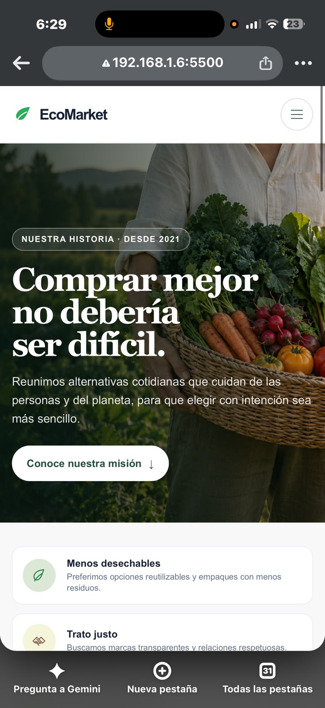
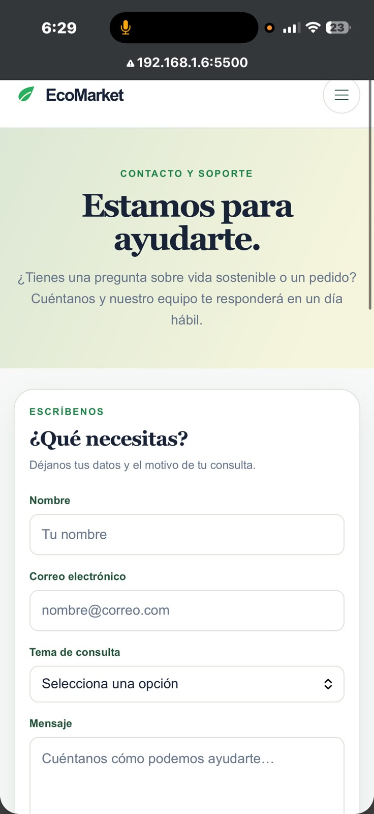
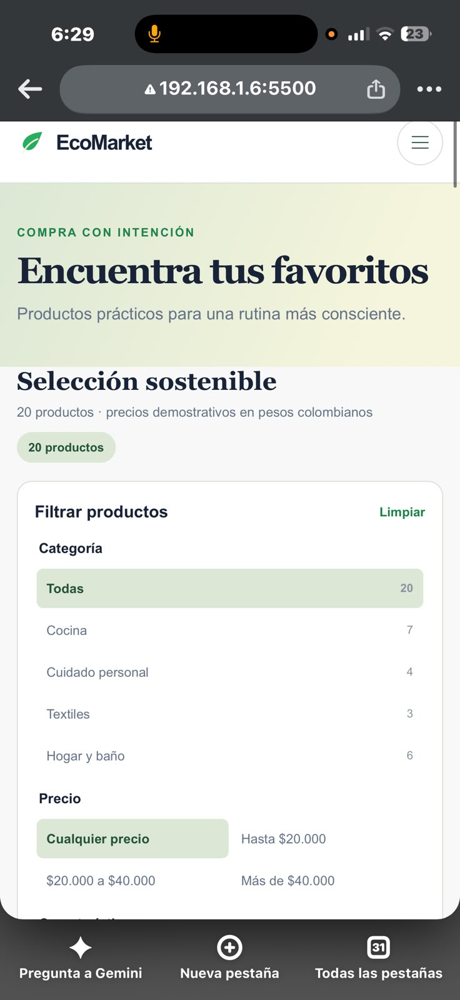
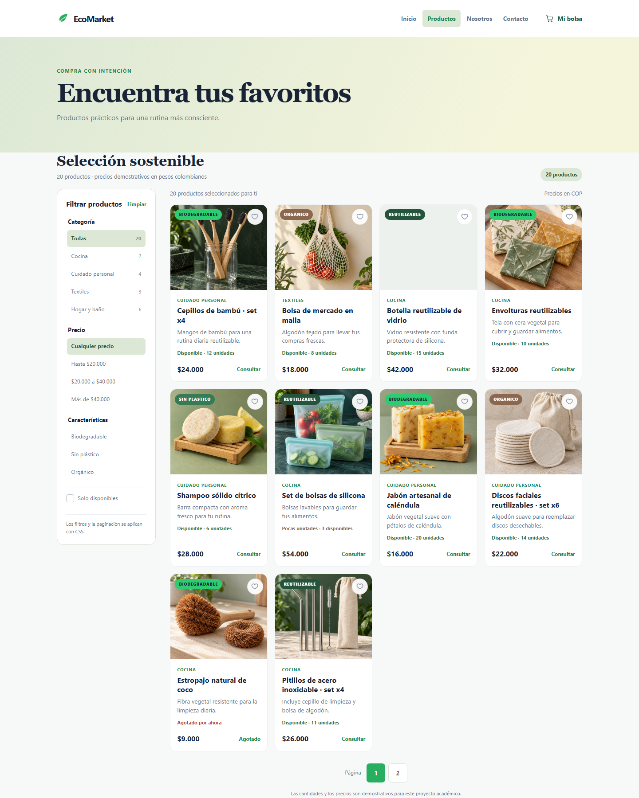

# EcoMarket

EcoMarket es una tienda demostrativa de productos sostenibles. El proyecto presenta un catálogo de artículos para el hogar y el cuidado personal, además de páginas informativas sobre la marca y un formulario de contacto.

## Cómo abrir el sitio

1. Descarga o clona este repositorio.
2. Abre la carpeta del proyecto en Visual Studio Code.
3. Abre `index.html` en el navegador o inicia **Live Server** desde ese archivo.
4. Usa la navegación del encabezado para visitar Productos, Nosotros y Contacto.

Con Live Server, las rutas locales normalmente son `http://127.0.0.1:5500/` para el inicio y `http://127.0.0.1:5500/views/productos.html` para el catálogo. El puerto puede cambiar si ya está ocupado.

## Publicación

URL pública del proyecto:

[https://anva100.github.io/EcoMarket_AndresVasquez/](https://anva100.github.io/EcoMarket_AndresVasquez/)

Para que GitHub Pages muestre las cuatro vistas completas, configura la rama `feature/documentacion` y la carpeta `/(root)` en **Settings → Pages**.

El catálogo incluye filtros y paginación visual implementados con CSS. La barra de búsqueda es una demostración visual; para que filtre texto se necesitaría JavaScript, que no se utiliza en esta entrega.

Cada nuevo commit en feature/documentacion vuelve a publicar el sitio automáticamente.

## Tecnologías

- HTML5 semántico y accesible.
- CSS3: variables, Flexbox, Grid, diseño adaptable, estados de interacción y animaciones.
- Imágenes PNG locales para productos y secciones destacadas.
- SVG en línea para iconos de interfaz.

No se requiere instalar dependencias ni compilar el proyecto.

## Páginas

- `index.html`: inicio y productos destacados.
- `views/productos.html`: catálogo con filtros y paginación visual.
- `views/sobre-nosotros.html`: historia, misión y principios de EcoMarket.
- `views/contacto.html`: formulario y datos de soporte demostrativos.

Las funciones de compra y contacto son demostrativas; el proyecto no procesa pagos ni envía mensajes a un servidor. Las opiniones y retratos de la página Nosotros también son ficticios y se usan solo como muestra.

## Capturas de pantalla

### Móvil

**Nosotros**



**Contacto**



**Productos**



### Escritorio

**Productos**



## Estructura del proyecto

```text
EcoMarket_AndresVasquez/
├── css/
│   ├── animations.css
│   ├── components.css
│   ├── layout.css
│   └── main.css
├── img/
│   ├── hero/
│   ├── icons/
│   ├── products/
│   ├── reviews/
│   └── screenshots/
├── views/
│   ├── contacto.html
│   ├── productos.html
│   └── sobre-nosotros.html
├── index.html
└── README.md
```
